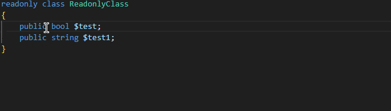
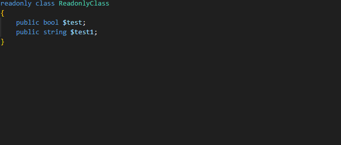
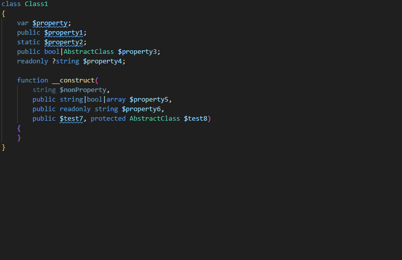
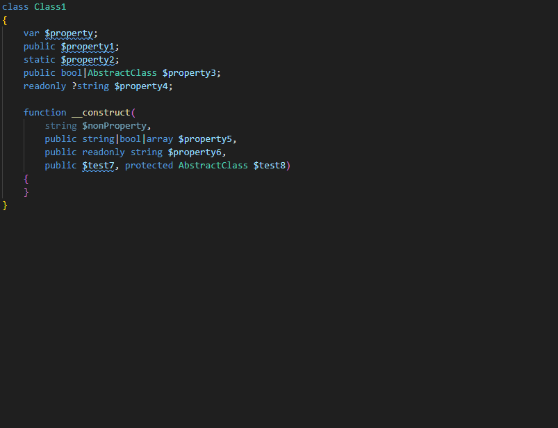
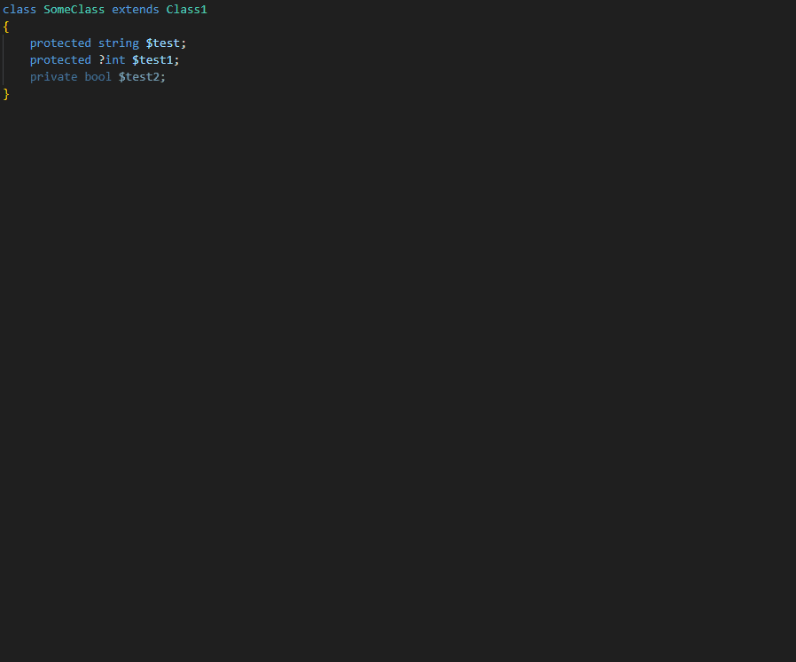

# PHP Getters & Setters Generator

A smart, high-speed, and automated PHP getters and setters generator for Visual Studio Code. It fully understands modern **PHP 8.x+** features and respects your code geometry (selections, multi-cursors) without breaking your workflow.

### Make getters inside readonly class:

### Make all getters inside readonly class:

### Make getters and setters:

### Make getters and setters for properties from constructor:

### Make all getters and setters for class:

## ✨ Features

- **Multi-Cursor Support (`Alt` + Click):** Select multiple properties at once, right-click, and generate all methods instantly.
- **Define in Constructor:** Select property declared inside class constructor method.
- **Smart Target Detection:** If no text is selected, it automatically detects the PHP property directly under your caret/cursor.
- **Whole Class Generation:** Click anywhere on an empty space inside a class, and it will generate methods for all properties at once.
- **PHP 8.2+ Readonly Class Support:** Automatically detects `readonly class` or `readonly` properties and generates **only getters** for them, protecting your code from runtime crash errors.
- **PHP 8.x+ Static Properties Support:** Smart generation for static properties (using `static::$prop` and returning `static` instead of `$this`).
- **Atomic Undo (`Ctrl + Z`):** All generated code across multiple classes is inserted in a single transaction. You can undo the entire generation with just one keystroke.

## ⚙️ Extension Settings

This extension contributes the following settings through the configuration panel (`Ctrl + ,`):

- `php-get-set-generator.indentation`: Choose your preferred code style layout (`2 spaces`, `4 spaces` (PSR standard), or `2 tabs`).
- `php-get-set-generator.fluentSetters`: If enabled, non-static setters will return `$this` for chained method calls (`$user->setName()->setAge()`).
- `php-get-set-generator.fluentSettersReturnType`: Choose what fluent setters should return as a type-hint: `static` or the actual `Class name`.
- `php-get-set-generator.getterPrefix`: Prefix for common property getter methods (e.g., `get`Name).
- `php-get-set-generator.getterBoolPrefix`: Prefix for boolean property getter methods (e.g., `is`Active).
- `php-get-set-generator.addVoidToSetters`: Whether to add the `: void` return type-hint for non-fluent standard setters.

## 🚀 How to Use

1. Open any PHP file.
2. Put your cursor on a property name (or select multiple properties using `Alt`).
3. Right-click anywhere in the editor and choose **PHP Getters and Setters** from the context menu.
4. Select one of the actions:
   - `Make Getters & Setters` (Generates both)
   - `Individual Methods...` ➡️ `Make Getter` / `Make Setter`

## 📋 Requirements

No external dependencies or PHP runtime required. The extension uses a lightning-fast native internal parser.

## 📄 License

This project is licensed under the **MIT License**.

## 🤝 Contact with me

I would be glad to hear your ideas, suggestions, and bug reports! 

| Contact Method | Link / Address |
| :--- | :--- |
| 📧 **Email** | [artemisamiddinov@gmail.com](mailto:artemisamiddinov@gmail.com) |
| 💬 **Telegram** | [@artemisamiddinov](https://t.me/artemisamiddinov) |